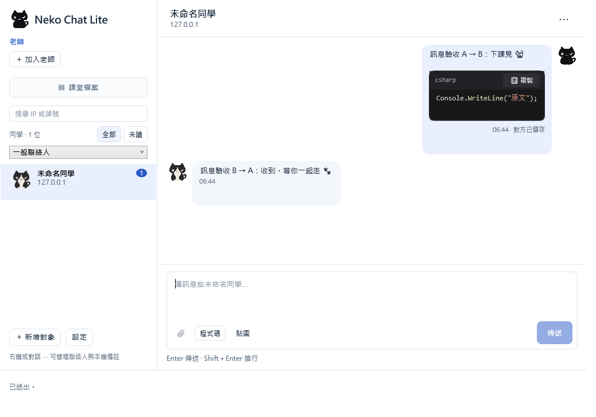
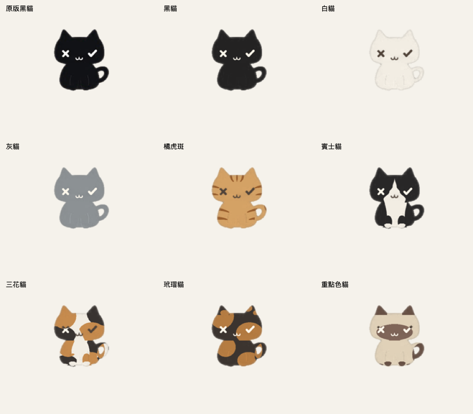
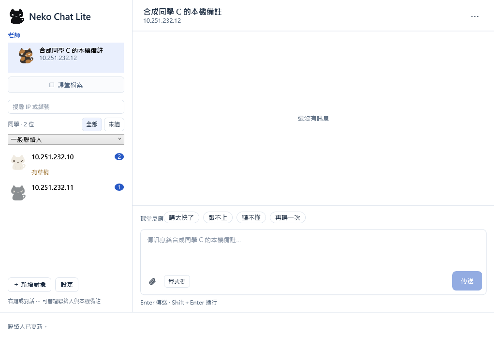
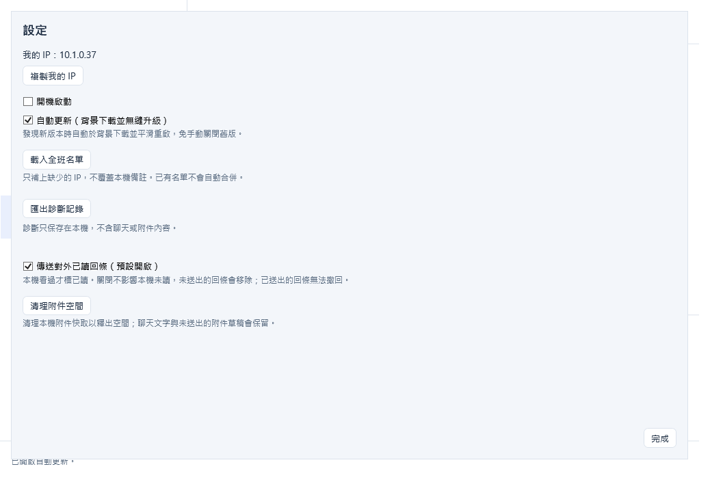

<p align="center">
  <a href="https://nekonode.cloud">
    <picture>
      <source media="(prefers-color-scheme: dark)" srcset="docs/media/brand/app-icon.svg">
      
    </picture>
  </a>
</p>

<h1 align="center">What's up my neighbor · Windows</h1>

<p align="center">
  <b>Voice input and classroom chat, with a little cat.</b><br>
  Two Windows apps: dictate into a text field, or chat and share files with classmates on your LAN.
</p>

<p align="center">
  <a href="https://github.com/yuipan0611/whats-up-my-neighbor-ai-input-windows/actions/workflows/windows.yml"></a>
  <a href="https://github.com/yuipan0611/whats-up-my-neighbor-ai-input-windows/actions/workflows/nekochat-windows-lite.yml"></a>
  <a href="https://github.com/yuipan0611/whats-up-my-neighbor-ai-input-windows/releases/tag/nekochat-lite-v0.1.0-beta.15"></a>
  
  <a href="LICENSE"></a>
</p>

<p align="center">
  <a href="https://nekonode.cloud"><b>Website</b></a> ·
  <a href="windows-lite/README.md">Lite guide</a> ·
  <a href="docs/VOICE-GUIDE.zh-TW.md">Voice guide</a> ·
  <a href="https://github.com/yuipan0611/whats-up-my-neighbor-ai-input-macos">macOS</a>
</p>

<p align="center">
  Language:
  <a href="README.md"><kbd>繁體中文</kbd></a>
  <a href="README.en.md"><kbd>English ✓</kbd></a>
  <a href="README.ja.md"><kbd>日本語</kbd></a>
</p>

---

> [!NOTE]
> The app interface and detailed manuals are primarily in **Traditional Chinese**. This page provides an English introduction and installation steps.

This Windows repository contains two separate apps: **Voice Input** transcribes speech into your current text field; **NekoChat Lite** lets classmates chat and share files on the same local network. Each has its own download and update process.

<p align="center">
  <br>
  <sub>NekoChat Lite on Windows, with demonstration data</sub>
</p>

## Choose your version

| What you want to do | Version | Download |
|---|---|---|
| Dictate into your current text field | Voice Input **0.1.0-beta.3** | [Voice installer](https://github.com/yuipan0611/whats-up-my-neighbor-ai-input-windows/releases/download/v0.1.0-beta.3/Neighbor-Setup-0.1.0-beta.3-x64.exe) · [Release notes](https://github.com/yuipan0611/whats-up-my-neighbor-ai-input-windows/releases/tag/v0.1.0-beta.3) |
| Chat and share files on a LAN, with a desktop cat | NekoChat Lite **0.1.0-beta.15** | [Lite installer](https://github.com/yuipan0611/whats-up-my-neighbor-ai-input-windows/releases/download/nekochat-lite-v0.1.0-beta.15/NekoChat-Setup-win-x64.exe) · [Portable EXE](https://github.com/yuipan0611/whats-up-my-neighbor-ai-input-windows/releases/download/nekochat-lite-v0.1.0-beta.15/NekoChat-Lite.exe) · [Release notes](https://github.com/yuipan0611/whats-up-my-neighbor-ai-input-windows/releases/tag/nekochat-lite-v0.1.0-beta.15) |

Both are testing releases. Lite needs neither a microphone nor an API key. Voice Input needs your own Groq API key and internet access. Lite messaging uses your LAN; checking and downloading updates requires access to GitHub.

## Features

### NekoChat Lite: classmates next door

- **Direct LAN chat**: enter a classmate's local IP without invitation codes. Add local contact notes and keep the teacher pinned at the top.
- **Text and files**: Enter sends; Shift+Enter adds a line. Send code, images and one attachment per message, up to 25 MiB. The classroom files area supports sharing and withdrawing your own files.
- **Nine desktop cat coats**: choose your companion and watch it walk, groom, yawn or rest. Pick it up and put it down.
- **Keep messages through a disconnection**: outgoing messages are saved locally and retried when the connection returns. Background retries preserve newer drafts.
- **Automatic updates by default in beta.15**: downloads run in the background with SHA-256 verification. A draft or active text composition defers restart; the installer handoff follows a successful save. You can turn this off in settings.

### Voice Input: say what's on your mind

- **Record and paste with a shortcut**: `Ctrl + Alt + Space` starts and stops recording. Groq Whisper transcribes and pastes into the original field. It **does not press Enter to send**.
- **Black cat recording overlay**: live volume display, X eye to cancel, check-mark eye to finish. Failed transcription can be retried while the recording is retained.
- **Vocabulary and correction learning**: manage custom terms and choose whether corrections in supported text fields become vocabulary entries.
- **Three output modes**: verbatim, standard and concise, with primary and mixed-language settings.

## Nine coats. Pick your companion.

NekoChat Lite includes all nine coats below. Switch from the cat's right-click menu; your choice is saved.

<p align="center">
  <br>
  <sub>Original black · Black · White · Gray · Orange tabby · Tuxedo · Calico · Tortoiseshell · Colorpoint</sub>
</p>

## Screenshots

<p align="center">
  
  <br>
  <sub>Pinned teacher, contacts and cat avatars; update, diagnostics and read-receipt settings. Demonstration data.</sub>
</p>

## Download and install

### NekoChat Lite

1. [Download and run Setup](https://github.com/yuipan0611/whats-up-my-neighbor-ai-input-windows/releases/download/nekochat-lite-v0.1.0-beta.15/NekoChat-Setup-win-x64.exe), or use the [portable EXE](https://github.com/yuipan0611/whats-up-my-neighbor-ai-input-windows/releases/download/nekochat-lite-v0.1.0-beta.15/NekoChat-Lite.exe). No separate .NET installation is needed.
2. Setup installs for the current Windows user. Initial inbound firewall configuration may require administrator approval; the portable app does not change firewall rules automatically.
3. Double-click the cat, choose 「新增對象」 (Add contact), and enter the classmate's LAN IP. Use 「加入老師」 (Add teacher) for the teacher. See the [Lite guide](windows-lite/README.md) in Traditional Chinese.
4. **beta.14 and older require one manual upgrade to beta.15.** Automatic background updates are enabled from beta.15 onward. Updating the portable app moves you to the installed version.

### Voice Input

1. [Download the Voice installer](https://github.com/yuipan0611/whats-up-my-neighbor-ai-input-windows/releases/download/v0.1.0-beta.3/Neighbor-Setup-0.1.0-beta.3-x64.exe) and open the app from the Start menu.
2. Create your own API key at [Groq Console](https://console.groq.com/keys). Save it through 「設定／更換 Groq 金鑰…」 (Set/change Groq key) in the cat's system-tray menu.
3. Click a text field, press `Ctrl + Alt + Space`, speak, and press it again to stop and paste. See the [full Voice guide](docs/VOICE-GUIDE.zh-TW.md) in Traditional Chinese.

**System**: Windows 11 x64 or Windows 10 22H2 x64. ARM64 is unverified. Voice Input uses the system's .NET Framework 4.8; Lite bundles its runtime. Voice Input upgrades use its own Setup and are separate from Lite automatic updates.

**SmartScreen**: installers are currently unsigned. Windows may display “Windows protected your PC.” Download only from this repository's Releases and verify the matching SHA-256. If needed, choose “More info” → “Run anyway”; do not disable system protection.

```powershell
Get-FileHash .\NekoChat-Setup-win-x64.exe -Algorithm SHA256
```

## Privacy and validation scope

- Voice recordings go to Groq for transcription. API keys stay in Windows Credential Manager, outside the repository and logs. See [PRIVACY.md](PRIVACY.md).
- Lite history, contact notes and drafts stay local. LAN traffic is not encrypted; an IP address or teacher label is not identity proof. Diagnostics stay local and are exported manually.
- Windows CI exercises Lite native WPF, messaging, installation and update handoff. **Two physical classroom PCs, AP/VLAN conditions, installed IMEs, physical DPI/multiple monitors and real cross-version automatic handoff still require on-site validation.** Voice Input has separate [validation notes](VALIDATION.md).

## Documentation

Detailed linked manuals are primarily in Traditional Chinese.

| What you want to do | Read |
|---|---|
| Use Lite chat, attachments and classroom files | [Lite guide](windows-lite/README.md) · [Attachments](windows-lite/ATTACHMENTS.md) |
| Configure voice, vocabulary, keys or uninstall | [Full Voice guide](docs/VOICE-GUIDE.zh-TW.md) |
| Check releases and update methods | [All releases](https://github.com/yuipan0611/whats-up-my-neighbor-ai-input-windows/releases) · [Lite beta.15](https://github.com/yuipan0611/whats-up-my-neighbor-ai-input-windows/releases/tag/nekochat-lite-v0.1.0-beta.15) · [Voice update process](docs/UPDATES.md) |
| Learn about the cat and platform differences | [Desktop cat](docs/DESKTOP-PET.md) · [Lite animation comparison](docs/LITE-ANIMATION-PARITY.md) |
| Develop and test | [Architecture](docs/ARCHITECTURE.md) · [Development](docs/DEVELOPMENT.md) · [Testing](docs/TESTING.md) |
| Contribute or report a problem | [CONTRIBUTING.md](CONTRIBUTING.md) · [Issues](https://github.com/yuipan0611/whats-up-my-neighbor-ai-input-windows/issues) · [SECURITY.md](SECURITY.md) |

## License and contributors

[MIT License](LICENSE). Maintained by [yuipan0611](https://github.com/yuipan0611). Main Windows contributor: [andrewchu0101](https://github.com/andrewchu0101). The [macOS app](https://github.com/yuipan0611/whats-up-my-neighbor-ai-input-macos) is developed and released separately; refer to each platform's documentation for supported features.
