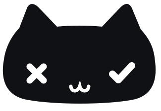
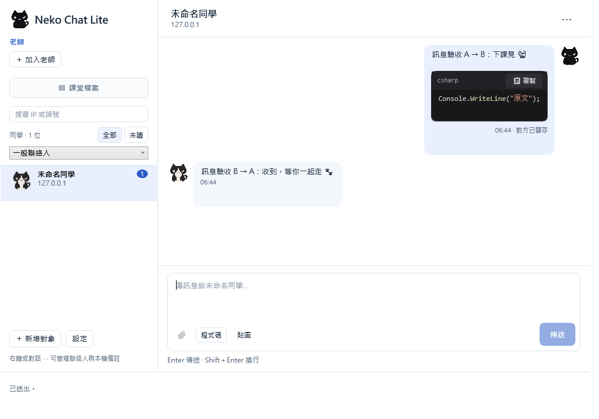
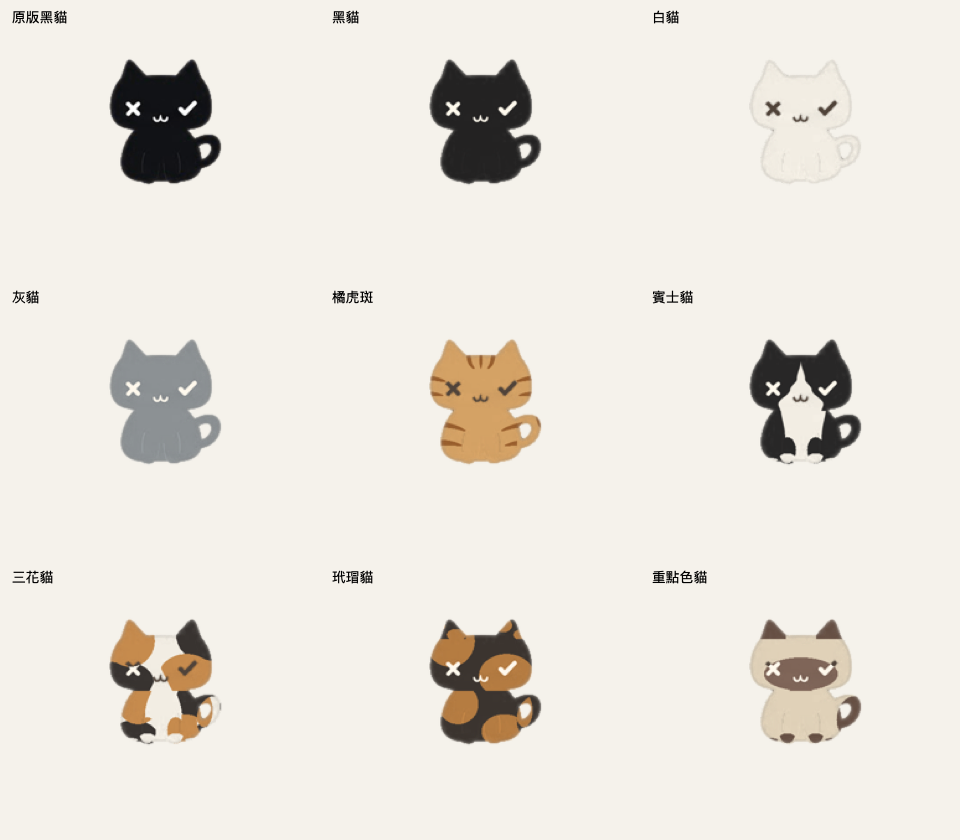
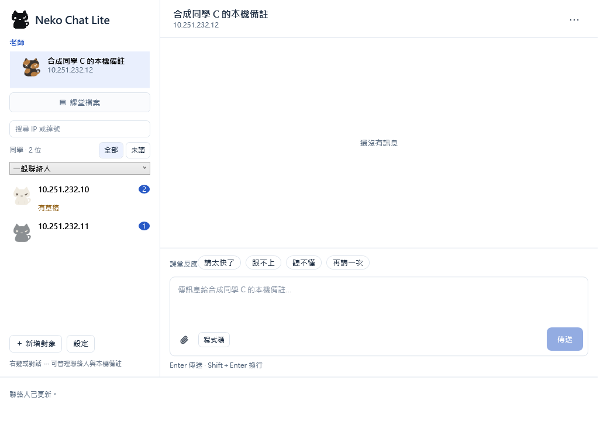
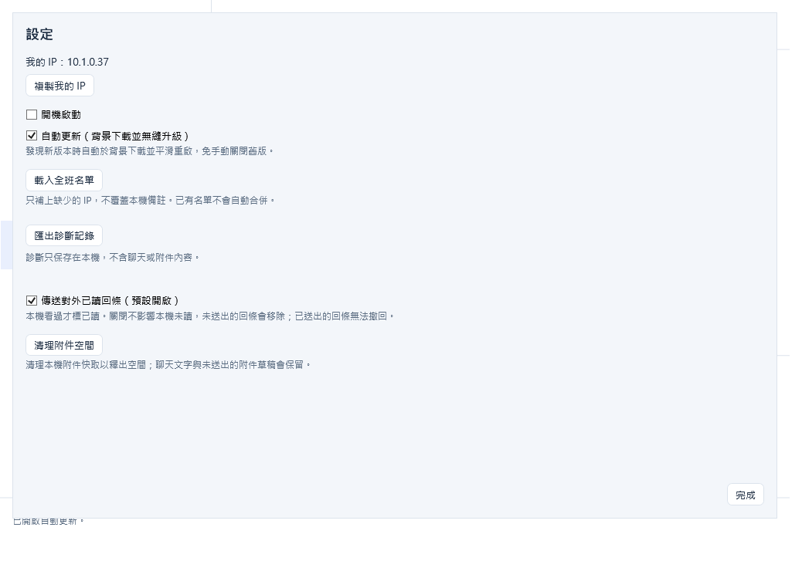

<p align="center">
  <a href="https://nekonode.cloud">
    <picture>
      <source media="(prefers-color-scheme: dark)" srcset="docs/media/brand/app-icon.svg">
      
    </picture>
  </a>
</p>

<h1 align="center">What's up my neighbor · Windows</h1>

<p align="center">
  <b>音声入力も、教室のチャットも。小さな猫と一緒に。</b><br>
  2 つの Windows アプリ：音声で入力、または同じ LAN のクラスメイトとチャット・ファイル共有。
</p>

<p align="center">
  <a href="https://github.com/yuipan0611/whats-up-my-neighbor-ai-input-windows/actions/workflows/windows.yml"></a>
  <a href="https://github.com/yuipan0611/whats-up-my-neighbor-ai-input-windows/actions/workflows/nekochat-windows-lite.yml"></a>
  <a href="https://github.com/yuipan0611/whats-up-my-neighbor-ai-input-windows/releases/tag/nekochat-lite-v0.1.0-beta.15"></a>
  
  <a href="LICENSE"></a>
</p>

<p align="center">
  <a href="https://nekonode.cloud"><b>公式サイト</b></a> ·
  <a href="windows-lite/README.md">Lite ガイド</a> ·
  <a href="docs/VOICE-GUIDE.zh-TW.md">音声ガイド</a> ·
  <a href="https://github.com/yuipan0611/whats-up-my-neighbor-ai-input-macos">macOS</a>
</p>

<p align="center">
  言語：
  <a href="README.md"><kbd>繁體中文</kbd></a>
  <a href="README.en.md"><kbd>English</kbd></a>
  <a href="README.ja.md"><kbd>日本語 ✓</kbd></a>
</p>

---

> [!NOTE]
> アプリの画面と詳細ガイドは主に **繁体字中国語** です。このページでは日本語で概要とインストール手順を説明します。

Windows 版には独立した 2 つのアプリがあります。**音声入力標準版**は話した内容を入力中の欄へ貼り付け、**NekoChat Lite**は同じ LAN のクラスメイトとチャットやファイル共有ができます。ダウンロードと更新はそれぞれ別です。

<p align="center">
  <br>
  <sub>デモ用データを使用した Windows 版 NekoChat Lite</sub>
</p>

## バージョンを選ぶ

| やりたいこと | バージョン | ダウンロード |
|---|---|---|
| 入力中のテキスト欄に音声で入力 | 音声入力標準版 **0.1.0-beta.3** | [音声版インストーラー](https://github.com/yuipan0611/whats-up-my-neighbor-ai-input-windows/releases/download/v0.1.0-beta.3/Neighbor-Setup-0.1.0-beta.3-x64.exe) · [リリース情報](https://github.com/yuipan0611/whats-up-my-neighbor-ai-input-windows/releases/tag/v0.1.0-beta.3) |
| LAN でチャット・ファイル共有、デスクトップ猫 | NekoChat Lite **0.1.0-beta.15** | [Lite インストーラー](https://github.com/yuipan0611/whats-up-my-neighbor-ai-input-windows/releases/download/nekochat-lite-v0.1.0-beta.15/NekoChat-Setup-win-x64.exe) · [ポータブル EXE](https://github.com/yuipan0611/whats-up-my-neighbor-ai-input-windows/releases/download/nekochat-lite-v0.1.0-beta.15/NekoChat-Lite.exe) · [リリース情報](https://github.com/yuipan0611/whats-up-my-neighbor-ai-input-windows/releases/tag/nekochat-lite-v0.1.0-beta.15) |

どちらもテスト版です。Lite はマイクも API キーも不要です。音声版には自分の Groq API キーとインターネット接続が必要です。Lite のチャットは LAN 内で動作し、更新の確認・ダウンロードには GitHub への接続が必要です。

## 特長

### NekoChat Lite：隣のクラスメイトへ

- **LAN で直接チャット**：相手のローカル IP を入力するだけで、招待コードは不要。連絡先にこの PC だけのメモを付けられ、先生は上部に固定されます。
- **文字もファイルも**：Enter で送信、Shift＋Enter で改行。コード・画像・1 件あたり最大 25 MiB の添付ファイルに対応。授業用ファイル欄では共有と自分の共有の取り下げができます。
- **9 種類のデスクトップ猫**：好きな毛色を選び、散歩、毛づくろい、あくび、休憩を楽しめます。持ち上げて下ろす操作にも対応します。
- **一時的な切断でも送信待ちを保持**：送信内容をローカルに保存し、接続復旧後に再送。後から書いた下書きは上書きしません。
- **beta.15 から自動更新が初期設定で有効**：バックグラウンドでダウンロードし SHA-256 を確認。下書きや文字の変換中は再起動を待ち、保存に成功してから引き継ぎます。設定で無効にできます。

### 音声入力標準版：思いついたら、声に出すだけ

- **ショートカットで録音、元の場所へ貼り付け**：`Ctrl + Alt + Space` で開始／停止。Groq Whisper で文字起こしし、元の入力欄に貼り付けます。**Enter による送信はしません**。
- **黒猫の録音オーバーレイ**：音量表示付き。左目の×でキャンセル、右目の✓で完了。認識失敗時は録音が保持されている間に再試行できます。
- **辞書と修正の学習**：独自の用語を管理し、対応する入力欄での修正を辞書に追加するか選べます。
- **3 種類の出力モード**：逐語・標準・簡潔。メイン言語と混在する言語を設定できます。

## 9 種類の毛色から、お気に入りの一匹を

NekoChat Lite には以下の 9 種類の毛色が入っています。猫の右クリックメニューから変更でき、選択は保存されます。

<p align="center">
  <br>
  <sub>オリジナル黒猫 · 黒猫 · 白猫 · グレー · 茶トラ · ハチワレ · 三毛 · サビ · ポイントカラー</sub>
</p>

## 画面紹介

<p align="center">
  
  <br>
  <sub>先生の固定、連絡先と猫のアバター。自動更新・診断・既読通知の設定。デモ用データです。</sub>
</p>

## ダウンロードとインストール

### NekoChat Lite

1. [Setup をダウンロード](https://github.com/yuipan0611/whats-up-my-neighbor-ai-input-windows/releases/download/nekochat-lite-v0.1.0-beta.15/NekoChat-Setup-win-x64.exe)して実行するか、[ポータブル版](https://github.com/yuipan0611/whats-up-my-neighbor-ai-input-windows/releases/download/nekochat-lite-v0.1.0-beta.15/NekoChat-Lite.exe)を使います。.NET の別途インストールは不要です。
2. Setup は現在の Windows ユーザー用フォルダーにインストールします。初回の受信ファイアウォール設定には管理者の承認が必要な場合があります。ポータブル版はルールを自動変更しません。
3. 猫をダブルクリックし、「新增對象」（連絡先追加）で相手の LAN IP を入力。先生には「加入老師」（先生を追加）を使います。[Lite ガイド](windows-lite/README.md)は繁体字中国語です。
4. **beta.14 以前は、まず beta.15 へ一度手動で更新してください。** beta.15 から自動更新が初期設定で有効です。ポータブル版から更新するとインストール版へ移行します。

### 音声入力標準版

1. [音声版 Setup](https://github.com/yuipan0611/whats-up-my-neighbor-ai-input-windows/releases/download/v0.1.0-beta.3/Neighbor-Setup-0.1.0-beta.3-x64.exe) をインストールし、スタートメニューから起動します。
2. [Groq Console](https://console.groq.com/keys) で自分の API キーを作成。猫のシステムトレイメニュー「設定／更換 Groq 金鑰…」（Groq キーの設定・変更）で保存します。
3. テキスト欄を選び、`Ctrl + Alt + Space` を押して話し、もう一度押すと停止して貼り付けます。[音声版の詳細ガイド](docs/VOICE-GUIDE.zh-TW.md)は繁体字中国語です。

**動作環境**：Windows 11 x64 または Windows 10 22H2 x64。ARM64 は未検証です。音声版は OS の .NET Framework 4.8 を使用し、Lite はランタイムを同梱します。音声版の更新は専用 Setup を使い、Lite の自動更新とは別です。

**SmartScreen**：現在のインストーラーは未署名です。「Windows によって PC が保護されました」と表示される場合があります。このリポジトリの Releases から取得し、同じ版の SHA-256 を確認してください。必要に応じて「詳細情報」→「実行」を選び、システム保護は無効にしないでください。

```powershell
Get-FileHash .\NekoChat-Setup-win-x64.exe -Algorithm SHA256
```

## プライバシーと検証範囲

- 音声は文字起こしのため Groq に送信されます。API キーは Windows 資格情報マネージャーに保存され、リポジトリやログには書き込みません。[PRIVACY.md](PRIVACY.md) を参照してください。
- Lite の履歴・連絡先メモ・下書きはローカル保存です。LAN 通信は暗号化されておらず、IP や先生ラベルは本人確認にはなりません。診断もローカルに保存し、手動でエクスポートします。
- Windows CI では Lite のネイティブ WPF、通信、インストール、更新引き継ぎを検証しています。**教室の実機 2 台、AP／VLAN、実際の IME、実機 DPI／複数画面、本当の異なるバージョン間の自動更新は現場検証が必要です。** 音声版の範囲は [VALIDATION.md](VALIDATION.md) に記載しています。

## ドキュメント

リンク先の詳細ガイドは主に繁体字中国語です。

| やりたいこと | 参照先 |
|---|---|
| Lite のチャット・添付・授業用共有 | [Lite ガイド](windows-lite/README.md) · [添付ファイル](windows-lite/ATTACHMENTS.md) |
| 音声・辞書・キーの設定、アンインストール | [音声版の詳細ガイド](docs/VOICE-GUIDE.zh-TW.md) |
| バージョンと更新方法 | [全リリース](https://github.com/yuipan0611/whats-up-my-neighbor-ai-input-windows/releases) · [Lite beta.15](https://github.com/yuipan0611/whats-up-my-neighbor-ai-input-windows/releases/tag/nekochat-lite-v0.1.0-beta.15) · [音声版の更新手順](docs/UPDATES.md) |
| 猫とプラットフォームの違い | [デスクトップ猫](docs/DESKTOP-PET.md) · [Lite アニメーション比較](docs/LITE-ANIMATION-PARITY.md) |
| 開発・テスト | [構成](docs/ARCHITECTURE.md) · [開発](docs/DEVELOPMENT.md) · [テスト](docs/TESTING.md) |
| 開発に参加・不具合を報告 | [CONTRIBUTING.md](CONTRIBUTING.md) · [Issues](https://github.com/yuipan0611/whats-up-my-neighbor-ai-input-windows/issues) · [SECURITY.md](SECURITY.md) |

## ライセンスと貢献者

[MIT License](LICENSE)。[yuipan0611](https://github.com/yuipan0611) が保守しています。Windows 版の主な貢献者は [andrewchu0101](https://github.com/andrewchu0101) です。[macOS 版](https://github.com/yuipan0611/whats-up-my-neighbor-ai-input-macos) は独立して開発・リリースされ、対応機能は各プラットフォームの説明を参照してください。
