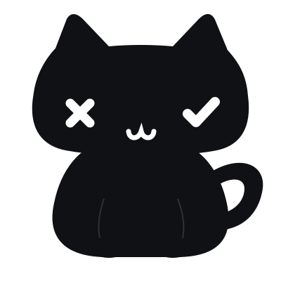

<div align="center">



# NekoChat · Windows

**把隔壁同學的訊息，交給桌面上的貓咪。**

內網 IP 直連 · 不用邀請碼 · 九種貓咪花色 · 課堂反應貼圖

**[下載 Windows 安裝版](https://github.com/yuipan0611/whats-up-my-neighbor-ai-input-windows/releases/download/nekochat-lite-v0.1.0-beta.7/NekoChat-Setup-win-x64.exe)** · [免安裝版](https://github.com/yuipan0611/whats-up-my-neighbor-ai-input-windows/releases/download/nekochat-lite-v0.1.0-beta.7/NekoChat-Lite.exe) · [版本說明](https://github.com/yuipan0611/whats-up-my-neighbor-ai-input-windows/releases/tag/nekochat-lite-v0.1.0-beta.7)

**目前最新教室測試版：0.1.0-beta.7** · Windows x64 · 未簽署的預發布版本

[快速開始](#三步開始聊天) · [下載怎麼選](#下載怎麼選) · [使用與安全](#使用前請留意) · [標準語音版](#標準語音版-neighbor) · [官方網站](https://nekonode.cloud)

</div>

---

## 下載怎麼選

兩個檔案**擇一**即可，不需要下載 Source code，也不用另裝 Python、.NET 或 API Key。

| 你想怎麼用 | 下載 beta.7 | 差別 |
|---|---|---|
| 第一次在教室使用 | **[NekoChat-Setup-win-x64.exe](https://github.com/yuipan0611/whats-up-my-neighbor-ai-input-windows/releases/download/nekochat-lite-v0.1.0-beta.7/NekoChat-Setup-win-x64.exe)** | 建議選這個；安裝時由有權限的人員完成一次管理員授權，設定同網段收訊規則。日常聊天不需管理員權限。 |
| 不安裝，直接開啟 | [NekoChat-Lite.exe](https://github.com/yuipan0611/whats-up-my-neighbor-ai-input-windows/releases/download/nekochat-lite-v0.1.0-beta.7/NekoChat-Lite.exe) | 單一 EXE；不會自動設定防火牆，仍需教室網路允許互連。 |

> **找最新版，不要只看 GitHub 的「Latest」。** 上方下載連結明確指向 **0.1.0-beta.7**。GitHub 的 Latest 與預發布版本是不同概念，目前舊 beta.4 被標為非預發布，因此 Latest 仍指向舊版；beta.7 保留正確的 Pre-release 標示。所有歷史版本都保留在 [Releases](https://github.com/yuipan0611/whats-up-my-neighbor-ai-input-windows/releases)。

[SHA-256 校驗碼與建置來源](https://github.com/yuipan0611/whats-up-my-neighbor-ai-input-windows/releases/tag/nekochat-lite-v0.1.0-beta.7) · [beta.7 完整更新說明](nekochat/docs/releases/nekochat-lite-v0.1.0-beta.7.md)

## 三步開始聊天

1. **兩台都更新**：先在舊貓咪上按右鍵 →「離開」，再開啟 beta.7。關閉聊天視窗只是隱藏，不是離開程式。
2. **交換內網 IP**：雙擊貓咪開啟聊天，確認顯示「接收已啟動」，輸入同學畫面上的內網 IP。教室聊天不需要帳號、建房或長邀請碼，也不依賴外網服務。
3. **傳一句話**：Enter 傳送，Shift＋Enter 換行；對方收到後會看到貓咪氣泡，點氣泡即可回覆。先確認雙向都能收到，再開始使用。

### 小貓能做什麼？

| 桌面陪伴 | 同學聊天 | 課堂互動 |
|---|---|---|
| 九種花色、動畫與自動散步，右鍵可暫停 | 內網 IP 直連、本機通訊錄、氣泡回覆 | 五款去背反應貼圖、兩秒中央提醒、可選提醒螢幕 |
| 雙擊開聊天、拖曳移動貓咪 | 送達確認；離線或未確認送達時保留草稿 | 老師與同學兩端都使用 beta.7 才能看到圖片效果 |

完整操作、老師 IP 設定與驗收方式見 **[Lite 教室版使用指南](windows-lite/README.md)**。

## 使用前請留意

- **這仍是測試版，不是正式穩定版。** beta.7 的 [Windows Lite 建置與驗證](https://github.com/yuipan0611/whats-up-my-neighbor-ai-input-windows/actions/runs/40663260847) 有對應來源與測試附件；自動測試不等於兩台實體教室電腦、投影／混合 DPI、實際中文輸入法與 UAC 操作皆已驗收。
- **可信內網限定**：聊天使用明文 TCP 8768；IP 是找到電腦的位置，不是對方身分驗證。只在可信教室網路傳非敏感內容。
- **不要關閉防護**：Setup 的網路設定仍受學校管理政策約束；取消授權、AP／VLAN 隔離或封鎖規則都可能影響收訊，請依提示交由教室管理者確認。
- **下載來源與雜湊**：僅從本專案 Releases 下載並核對同名 `.sha256`；未簽署程式可能觸發 SmartScreen。若校方政策不允許執行，請交由管理者處理，不要停用防護。
- **更新不會靜默安裝**：貓咪右鍵「檢查更新」可查看版本；下載新版前先離開舊程式。教室沒有外網時，可先在可連網處取得安裝檔。

<details>
<summary>查看 PowerShell 校驗方式</summary>

```powershell
Get-FileHash .\NekoChat-Setup-win-x64.exe -Algorithm SHA256
# 免安裝版：
Get-FileHash .\NekoChat-Lite.exe -Algorithm SHA256
```

將輸出與同一個 beta.7 Release 中對應的 `.sha256` 比對。

</details>

## 這個倉庫有兩個 Windows 版本

|  | NekoChat Lite（本頁主角） | Neighbor 標準語音版 |
|---|---|---|
| 用途 | 教室內網聊天與桌面貓咪 | 全域快捷鍵 AI 語音輸入 |
| 網路與帳號 | 聊天走內網，不需要 API Key | 語音上傳 Groq，需網路與自己的 API Key |
| 下載辨識 | `NekoChat-*.exe` | `Neighbor-Setup-*.exe` |
| 版本線 | `nekochat-lite-v0.1.0-beta.7` | `v0.1.0-beta.3`（獨立發布） |

**不要把兩條版本線的功能、測試或安裝權限混為一談。** Lite 的測試結果不代表標準語音版測試已通過。macOS 另見 [Mac repo](https://github.com/yuipan0611/whats-up-my-neighbor-ai-input-macos)，功能與發布各自獨立。

## 標準語音版 Neighbor

<details>
<summary>展開：原版 AI 語音輸入、下載安裝、隱私與開發文件</summary>

小黑貓語音輸入工具（Windows 版）：按快捷鍵說話，再按一次完成，錄音送到 Groq 辨識，然後把文字貼到目前的輸入框。**只貼上，不會自動按 Enter 送出訊息。**

目前版本：**0.1.0-beta.3（預發布測試版）**。實機驗收尚未完成，見 [VALIDATION.md](VALIDATION.md)。

本 repo 是 Windows 版的正式 repo，由 yuipan0611 維護與發布，授權為 MIT（見 [LICENSE](LICENSE)）。Windows 版主要貢獻者：[andrewchu0101](https://github.com/andrewchu0101)。macOS 版在 [Mac repo](https://github.com/yuipan0611/whats-up-my-neighbor-ai-input-macos)。Windows 版與 macOS 版各自開發、各自發布；功能不完全對等，以本文件列出的內容為準。

## 桌面小黑貓（Windows 第一階段）

預設關閉，與 macOS 版第一次使用的狀態一致。開啟後，小黑貓會在螢幕工作區底部散步與休息。右下角系統匣選單的「桌面小黑貓散步」可開關，設定會保存。貓咪視窗不搶焦點；只有貓咪身體接收滑鼠，可按住拖曳，放開後在新高度水平散步，透明區域仍會穿透到後面的視窗；錄音與辨識期間、鎖定、休眠及全螢幕時隱藏，恢復後繼續。Windows 實際桌面行為仍待人工驗收。

素材及腳步參考原作者 macOS 版，保持 X 左眼與勾勾右眼。這是第一階段功能同步，已支援拖曳（放開後只水平散步），尚未包含舔掌、抓起動畫、資料夾停靠與其他 macOS 桌面互動。錄音浮窗的眼睛操作維持原樣。

## 版本與發布流程

- 版本號只在 [VERSION](VERSION) 檔案維護。
- 發布流程見 [docs/UPDATES.md](docs/UPDATES.md)。流程會建置、測試、打包、做安裝測試，全部通過後才建立預發布版本。
- 本版不做程式內自動更新。要升級時，下載新版安裝檔直接執行即可，設定、詞典與 API Key 會保留。
- 版本紀錄見 [CHANGELOG.md](CHANGELOG.md)，發布說明見 [RELEASE_NOTES.md](RELEASE_NOTES.md)。

## 下載與安裝

到 [標準語音版 beta.3 Release](https://github.com/yuipan0611/whats-up-my-neighbor-ai-input-windows/releases/tag/v0.1.0-beta.3) 下載此版本，只需要一個檔案：

```text
Neighbor-Setup-<版本>-x64.exe
```

同一個 Release 另附 `.sha256` 校驗碼與 `build-manifest.json`。不需要下載原始碼，也不需要安裝 Python、Node.js 或其他開發工具。

**系統需求**

- Windows 11 x64，或 Windows 10 22H2 x64。
- 系統內建 .NET Framework 4.8（Windows 10 22H2 與 Windows 11 預設已有；安裝程式會先檢查，不會下載額外的執行環境）。
- 麥克風與網路。
- 不需要系統管理員權限；安裝到目前使用者的個人資料夾。
- ARM64 未驗證。

**安裝步驟**

1. 執行安裝程式。
2. 從開始功能表開啟 **What's up my neighbor**，右下角系統匣會出現黑貓。
3. 第一次使用時，依提示儲存自己的 Groq API Key（見下一節）。

**關於未簽章的提示**

這是未購買程式碼簽章的測試版。Windows 第一次執行時可能顯示「Windows 已保護你的電腦」，請點選 **其他資訊**，再點選 **仍要執行**。請只從本專案的 Releases 下載，並核對 SHA-256。不要為了安裝而關閉系統防護。

PowerShell 核對雜湊：

```powershell
Get-FileHash .\Neighbor-Setup-<版本>-x64.exe -Algorithm SHA256
```

## 建立 Groq API Key

1. 到 [Groq 控制台](https://console.groq.com/keys) 建立自己的 API Key。
2. 在系統匣的黑貓上按滑鼠右鍵，選擇 **設定／更換 Groq 金鑰…**。
3. 把 Key 貼入安全輸入欄並儲存。

App 不會替你購買 API 額度；額度或費用依你的 Groq 帳號方案計算。金鑰只存在目前 Windows 帳號的認證管理員中，目標名稱為 `WhatsUpMyNeighbor/GroqApiKey`。

## 使用方式

1. 點一下想輸入文字的欄位。
2. 按 **Ctrl + Alt + Space** 開始錄音，再按一次完成。
3. 浮窗中的小黑貓左眼可取消，右眼可完成；辨識失敗時錄音會保留兩分鐘，右眼可重試，也可從系統匣選擇 **重新辨識保留錄音**。
4. 文字會貼到目前的輸入框。若無法確認輸入框，文字仍會留在剪貼簿，請按 **Ctrl + V** 手動貼上。

## 功能

- 快捷鍵：預設 Ctrl + Alt + Space，可在設定中改為主要與第二組快捷鍵。
- 麥克風：可在設定中選擇輸入裝置，錄音浮窗顯示真實音量。
- 輸出模式：純逐字（預設）、標準、簡潔。
- 語言：預設繁體中文加英文，可選九種主要語言，並可設定最多兩種混用語言。
- 數字：中文數字轉換預設關閉。
- 靜音停止：預設關閉，可選 3、5 或 10 秒。每段錄音最多五分鐘。
- 詞典：最多 200 個詞，每個詞最多 40 個 Unicode 字元。可搜尋、新增、修改、啟用／停用、釘選與刪除；超出提示字數上限的詞條會顯示為未納入。
- 修字學習：在支援的輸入框中，貼入後修正同一欄位裡的一個詞，修正穩定後會顯示提示，可選擇加入詞典或不加入。不支援的應用程式可手動新增詞條。學習是提示詞管理，**不是重新訓練語音模型**。
- 登入時啟動：預設關閉，需要在設定中自行開啟。

## 隱私

- 每次錄音都會上傳到 `api.groq.com`，使用模型 `whisper-large-v3`。沒有聊天改寫，也沒有其他供應商的備援。
- API Key 只存在 Windows 認證管理員中，不寫入設定檔或記錄檔。
- 設定與詞典儲存在 `%LOCALAPPDATA%\WhatsUpMyNeighbor`。
- App 不寫入日常完整逐字稿，也不記錄金鑰。辨識與修字觀察所需的文字只短暫保留在記憶體中。
- 成功複製、取消、捨棄或新錄音取代時，錄音檔會刪除。
- 剪貼簿由 Windows 管理，可能受你自己開啟的剪貼簿歷程或同步設定影響。
- 詳見 [PRIVACY.md](PRIVACY.md)。

## 故障排除

- **沒有錄音**：在系統匣選擇 **Windows 麥克風隱私設定**，確認允許桌面應用程式使用麥克風，並確認選到正確的裝置。
- **無法自動貼上**：對以系統管理員權限執行的程式、密碼欄位、無法識別的輸入框，或中文組字狀態不明時，App 只會複製文字。請按 Ctrl + V 手動貼上。
- **沒有修字提示**：需要輸入框提供可靠的 UI Automation 文字範圍。開啟 **詞典與學習狀態** 可以看到原因，也可以手動新增。
- **辨識結果不正確**：短句、靜音或語言判斷錯誤時，App 目前沒有完整防護。請核對辨識結果。
- **額度或網路錯誤**：App 會顯示錯誤，不會無限重試、不會更換模型，也不會自動付費。

## 解除安裝

到 Windows **設定 → 應用程式**，移除 What's up my neighbor。設定、詞典與 API Key 預設保留；要完整清除時，先在 App 中移除金鑰，再刪除 `%LOCALAPPDATA%\WhatsUpMyNeighbor`。

## 從原始碼建置

見 [docs/DEVELOPMENT.md](docs/DEVELOPMENT.md)。測試方式與人工驗收清單見 [docs/TESTING.md](docs/TESTING.md)。

## 文件

| 文件 | 內容 |
|---|---|
| [CHANGELOG.md](CHANGELOG.md) | 版本紀錄 |
| [RELEASE_NOTES.md](RELEASE_NOTES.md) | 發布說明範本 |
| [docs/DEVELOPMENT.md](docs/DEVELOPMENT.md) | 開發環境與本機建置 |
| [docs/ARCHITECTURE.md](docs/ARCHITECTURE.md) | 架構與資料流 |
| [docs/TESTING.md](docs/TESTING.md) | 測試方式、覆蓋範圍與人工驗收清單 |
| [docs/UPDATES.md](docs/UPDATES.md) | 發布、校驗與升級流程 |
| [docs/WEBSITE.md](docs/WEBSITE.md) | 官網交付資料 |
| [VALIDATION.md](VALIDATION.md) | 已驗證與待實機驗收的範圍 |
| [MIGRATION.md](MIGRATION.md) | 從原專案拆分為獨立 repo 的紀錄 |
| [PRIVACY.md](PRIVACY.md)、[SECURITY.md](SECURITY.md) | 隱私與安全性 |
| [CONTRIBUTING.md](CONTRIBUTING.md) | 回報測試結果與參與開發 |

## 不在本版範圍

iPhone 接力、跨裝置詞典同步、多人會議分人、本機 AI 模型，以及 macOS 版的其他功能。

</details>

---

由 [yuipan0611](https://github.com/yuipan0611) 維護與發布 · Windows 版主要貢獻者 [andrewchu0101](https://github.com/andrewchu0101) · [MIT License](LICENSE)
