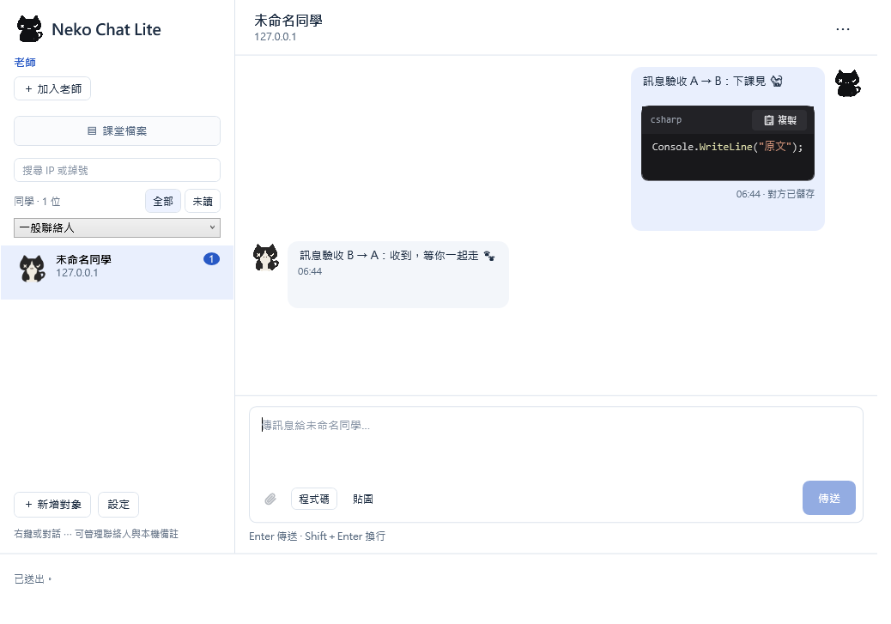
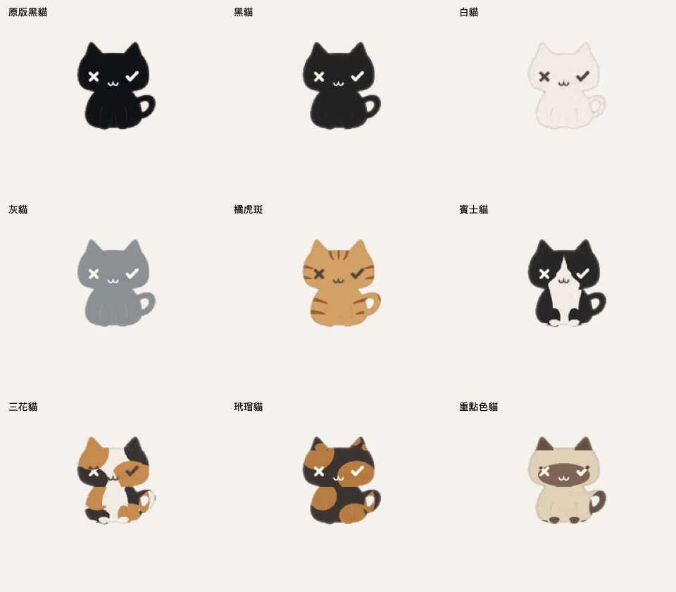
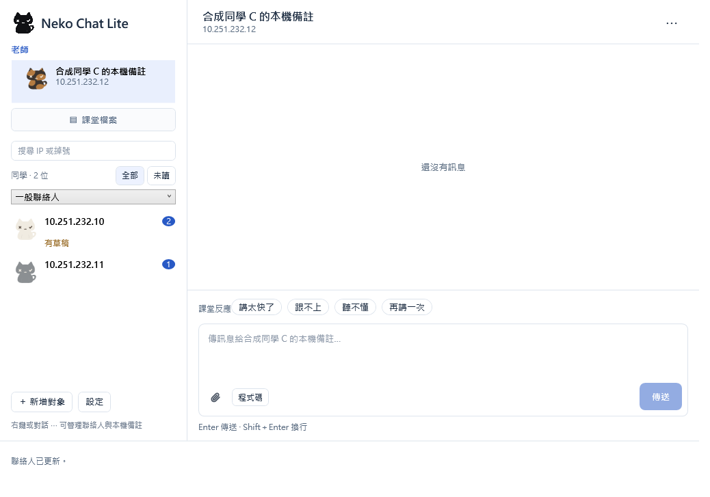
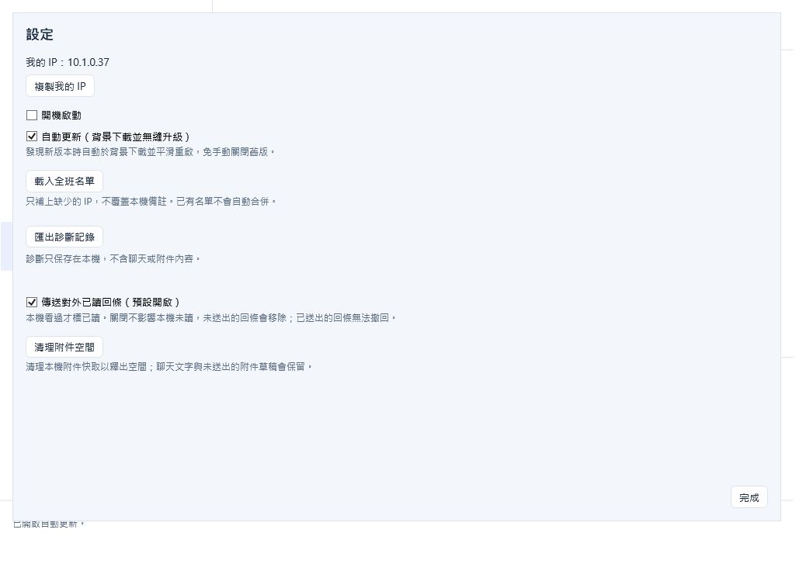

<p align="center">
  <a href="https://nekonode.cloud">
    <picture>
      <source media="(prefers-color-scheme: dark)" srcset="docs/media/brand/app-icon.svg">
      
    </picture>
  </a>
</p>

<h1 align="center">What's up my neighbor · Windows</h1>

<p align="center">
  <b>語音輸入與教室聊天，都有小黑貓陪你。</b><br>
  兩款 Windows App：用說話輸入文字，或在同一內網和同學聊天傳檔。
</p>

<p align="center">
  <a href="https://github.com/yuipan0611/whats-up-my-neighbor-ai-input-windows/actions/workflows/windows.yml"></a>
  <a href="https://github.com/yuipan0611/whats-up-my-neighbor-ai-input-windows/actions/workflows/nekochat-windows-lite.yml"></a>
  <a href="https://github.com/yuipan0611/whats-up-my-neighbor-ai-input-windows/releases/tag/nekochat-lite-v0.1.0-beta.15"></a>
  
  <a href="LICENSE"></a>
</p>

<p align="center">
  <a href="https://nekonode.cloud"><b>官方網站</b></a> ·
  <a href="windows-lite/README.md">Lite 指南</a> ·
  <a href="docs/VOICE-GUIDE.zh-TW.md">語音指南</a> ·
  <a href="https://github.com/yuipan0611/whats-up-my-neighbor-ai-input-macos">macOS</a>
</p>

<p align="center">
  語言：
  <a href="README.md"><kbd>繁體中文 ✓</kbd></a>
  <a href="README.en.md"><kbd>English</kbd></a>
  <a href="README.ja.md"><kbd>日本語</kbd></a>
</p>

---

What's up my neighbor 的 Windows repo 提供兩款獨立 App：**語音標準版**把說話轉成文字，**NekoChat Lite**讓同一內網的同學聊天、傳檔。兩款各自下載、各自更新。

<p align="center">
  <br>
  <sub>NekoChat Lite 的原生 Windows 介面，使用示範資料</sub>
</p>

## 選擇你的版本

| 想做什麼 | 版本 | 下載 |
|---|---|---|
| 在目前的文字欄位用說話輸入 | 語音標準版 **0.1.0-beta.3** | [標準版安裝檔](https://github.com/yuipan0611/whats-up-my-neighbor-ai-input-windows/releases/download/v0.1.0-beta.3/Neighbor-Setup-0.1.0-beta.3-x64.exe) · [版本說明](https://github.com/yuipan0611/whats-up-my-neighbor-ai-input-windows/releases/tag/v0.1.0-beta.3) |
| 和同學內網聊天、傳檔，讓貓咪在桌面散步 | NekoChat Lite **0.1.0-beta.15** | [Lite 安裝檔](https://github.com/yuipan0611/whats-up-my-neighbor-ai-input-windows/releases/download/nekochat-lite-v0.1.0-beta.15/NekoChat-Setup-win-x64.exe) · [免安裝 EXE](https://github.com/yuipan0611/whats-up-my-neighbor-ai-input-windows/releases/download/nekochat-lite-v0.1.0-beta.15/NekoChat-Lite.exe) · [版本說明](https://github.com/yuipan0611/whats-up-my-neighbor-ai-input-windows/releases/tag/nekochat-lite-v0.1.0-beta.15) |

兩款目前都作為測試版提供。Lite 不需要麥克風或 API Key；語音標準版需要自己的 Groq API Key 與網路。Lite 聊天走內網，檢查與下載新版需要連線 GitHub。

## 特色

### NekoChat Lite：同學就在隔壁

- **內網直接聊天**：填入同學的內網 IP，免邀請碼；聯絡人可加本機備註，老師置頂。
- **傳文字，也傳檔案**：Enter 傳送、Shift＋Enter 換行，支援程式碼、圖片與單一附件（每則最多 25 MiB）。課堂檔案區可分享與撤下自己的檔案。
- **桌面貓咪與九種花色**：選擇喜歡的貓咪，散步、舔掌、打哈欠、休息，也可以拎起與放下。
- **暫時斷線也保留待送**：訊息先保存在本機，恢復連線後續送；後續草稿不會被背景重試覆蓋。
- **beta.15 預設自動更新**：背景下載與核對 SHA-256；有聊天草稿或正在組字時等待，完成存稿才交接重啟。設定可關閉。

### 語音標準版：想到什麼，就說出來

- **快捷鍵錄音、貼回原位**：預設 `Ctrl + Alt + Space` 開始／停止；Groq Whisper 辨識後貼回原本的文字欄位，**不會按 Enter 送出**。
- **黑貓錄音浮窗**：顯示即時音量，左眼取消、右眼完成；辨識失敗可在保留期間重試。
- **詞典與修字學習**：可管理自訂詞彙；在支援的輸入框修正文字後，選擇是否加入詞典。
- **三種輸出模式**：純逐字、標準、簡潔；支援主要與混用語言設定。

## 九種花色，挑一隻陪你

NekoChat Lite 內建下列九種花色。從貓咪右鍵選單切換，會記住上次的選擇。

<p align="center">
  <br>
  <sub>原版黑貓 · 黑貓 · 白貓 · 灰貓 · 橘虎斑 · 賓士貓 · 三花貓 · 玳瑁貓 · 重點色貓</sub>
</p>

## 操作畫面

<p align="center">
  
  <br>
  <sub>老師置頂、同學名單與貓咪頭像；自動更新、診斷及已讀回條設定。畫面使用示範資料。</sub>
</p>

## 下載與安裝

### NekoChat Lite

1. [下載 Setup](https://github.com/yuipan0611/whats-up-my-neighbor-ai-input-windows/releases/download/nekochat-lite-v0.1.0-beta.15/NekoChat-Setup-win-x64.exe) 並執行；也可選擇[免安裝版](https://github.com/yuipan0611/whats-up-my-neighbor-ai-input-windows/releases/download/nekochat-lite-v0.1.0-beta.15/NekoChat-Lite.exe)，不需另裝 .NET。
2. Setup 安裝到目前 Windows 使用者的個人資料夾；首次設定收訊防火牆時可能要求管理員同意。免安裝版不會自動改防火牆。
3. 雙擊貓咪開聊天，按「新增對象」填同學內網 IP；老師用「加入老師」。詳見 [Lite 使用說明](windows-lite/README.md)。
4. **beta.14 或更舊版需先手動更新一次到 beta.15**；beta.15 起預設背景自動更新。免安裝版要求更新時會轉至安裝版。

### 語音標準版

1. [下載標準版 Setup](https://github.com/yuipan0611/whats-up-my-neighbor-ai-input-windows/releases/download/v0.1.0-beta.3/Neighbor-Setup-0.1.0-beta.3-x64.exe) 安裝，從開始功能表開啟 App。
2. 到 [Groq Console](https://console.groq.com/keys) 建立自己的 API Key，在黑貓系統匣選單「設定／更換 Groq 金鑰…」儲存。
3. 點一下文字欄位，按 `Ctrl + Alt + Space` 說話，再按一次停止並貼上。[完整語音指南](docs/VOICE-GUIDE.zh-TW.md)。

**系統**：Windows 11 x64，或 Windows 10 22H2 x64；ARM64 尚未驗證。語音標準版使用系統 .NET Framework 4.8，Lite 自帶執行環境。語音標準版升級需下載對應 Setup，與 Lite 自動更新分開。

**SmartScreen**：目前安裝檔未簽署，Windows 可能顯示「Windows 已保護你的電腦」。請只從本 repo 的 Release 下載並核對同版 SHA-256；需要時選「其他資訊」→「仍要執行」，不要關閉系統防護。

```powershell
Get-FileHash .\NekoChat-Setup-win-x64.exe -Algorithm SHA256
```

## 隱私與驗證範圍

- 語音只為轉錄傳至 Groq；API Key 存在 Windows 認證管理員，不寫入 repo 或日誌。詳見 [隱私說明](PRIVACY.md)。
- Lite 的聊天紀錄、綽號與草稿保存在本機；內網通訊未加密，IP 或老師標籤不是身分證明。診斷只保存在本機，需手動匯出。
- Windows CI 已執行 Lite 的原生 WPF、收發、安裝與更新交接驗證；**教室雙實機、AP／VLAN、實裝輸入法、實體 DPI／多螢幕與真正跨版本自動交接仍待現場驗收**。語音標準版界線另見 [VALIDATION.md](VALIDATION.md)。

## 文件

| 想做什麼 | 看這裡 |
|---|---|
| 使用 Lite 聊天、附件與課堂分享 | [Lite 指南](windows-lite/README.md) · [附件](windows-lite/ATTACHMENTS.md) |
| 設定語音、詞典、金鑰與解除安裝 | [語音標準版完整指南](docs/VOICE-GUIDE.zh-TW.md) |
| 看版本與更新方式 | [所有 Releases](https://github.com/yuipan0611/whats-up-my-neighbor-ai-input-windows/releases) · [Lite beta.15](https://github.com/yuipan0611/whats-up-my-neighbor-ai-input-windows/releases/tag/nekochat-lite-v0.1.0-beta.15) · [語音更新流程](docs/UPDATES.md) |
| 了解貓咪與平台差異 | [桌面貓咪](docs/DESKTOP-PET.md) · [Lite 動畫對照](docs/LITE-ANIMATION-PARITY.md) |
| 開發與測試 | [架構](docs/ARCHITECTURE.md) · [開發](docs/DEVELOPMENT.md) · [測試](docs/TESTING.md) |
| 參與開發、回報問題 | [CONTRIBUTING.md](CONTRIBUTING.md) · [Issues](https://github.com/yuipan0611/whats-up-my-neighbor-ai-input-windows/issues) · [SECURITY.md](SECURITY.md) |

## 授權與貢獻

[MIT License](LICENSE)。由 [yuipan0611](https://github.com/yuipan0611) 維護；Windows 版主要貢獻者：[andrewchu0101](https://github.com/andrewchu0101)。[macOS 版](https://github.com/yuipan0611/whats-up-my-neighbor-ai-input-macos) 各自開發與發布，功能依各平台文件為準。
